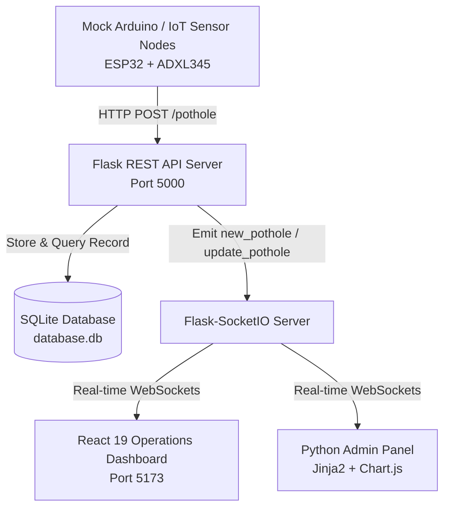

# ORAMA - Smart Pothole Detection & Municipal Road Monitoring System

[](https://react.dev/)
[](https://vitejs.dev/)
[](https://www.python.org/)
[](https://flask.palletsprojects.com/)
[](https://socket.io/)
[](https://leafletjs.com/)
[](https://www.sqlite.org/)

**ORAMA** (also known as **Netra / Horama AI**) is an enterprise-grade, real-time IoT road surveillance and municipal asset management platform. It combines edge telematics simulation, real-time bidirectional WebSocket event streaming, geospatial clustering, and automated repair route optimization to detect, monitor, and resolve road surface defects (potholes) dynamically.

---

## Table of Contents

- [Key Features](#-key-features)
- [System Architecture](#-system-architecture)
- [Tech Stack](#-tech-stack)
- [Directory Structure](#-directory-structure)
- [Prerequisites](#-prerequisites)
- [Installation & Setup](#-installation--setup)
  - [1. Clone Repository (Git)](#1-clone-repository-git)
  - [2. Backend Setup (Flask & SQLite)](#2-backend-setup-flask--sqlite)
  - [3. Frontend Setup (React & Vite)](#3-frontend-setup-react--vite)
  - [4. Edge IoT Simulator (Mock Arduino)](#4-edge-iot-simulator-mock-arduino)
- [Application Portals & Access](#-application-portals--access)
- [REST API Reference](#-rest-api-reference)
- [Smart Algorithms](#-smart-algorithms)
  - [Geospatial Clustering & TSP Dispatch](#geospatial-clustering--tsp-dispatch)
  - [Proximity Reverse Geocoding](#proximity-reverse-geocoding)
- [Troubleshooting & FAQs](#-troubleshooting--faqs)
- [Roadmap](#-roadmap)
- [Author & Acknowledgments](#-author--acknowledgments)

---

## 🌟 Key Features

* **Real-Time Edge Telematics**: Ingests accelerometer vibration and GPS telematics events via lightweight REST endpoints.
* **Instant WebSocket Broadcasting**: Utilizes Flask-SocketIO to instantly broadcast new detections and status updates with zero-latency push to connected clients.
* **Interactive GIS Map Tracker**: Built with Leaflet & CartoDB Dark Matter tiles, featuring custom glowing SVG markers color-coded by severity, radar pulses, and direct links to Google Maps navigation.
* **AI Maintenance Dispatch & TSP Route Planner**: Dynamically clusters unresolved potholes across 3 municipal zones (North, South, East) and solves the Traveling Salesperson Problem (TSP) using a nearest-neighbor algorithm to deliver optimized crew routes.
* **Dual Interface Design**:
  * **React 19 Operations Dashboard**: Real-time stats, audio alert beeps, multi-parameter search/filtering, device battery/RSSI telemetry, maintenance ticket workflow, and road hazard index heatmaps.
  * **Flask Admin Portal**: Server-rendered Jinja2 interface with Chart.js analytics for municipal oversight, status management, and audit logs.
* **Automated Reporting**: Instant client-side CSV report compilation for municipal audits and engineer logs.

---

## 🚀 System Architecture



---

## 🛠️ Tech Stack

| Domain | Technologies & Libraries |
| :--- | :--- |
| **Frontend** | React 19, Vite 8, Leaflet, React-Leaflet, Axios, Socket.IO Client, Lucide React, Glassmorphism CSS |
| **Backend** | Python 3.10+, Flask 3.1, Flask-SocketIO 5.6, Eventlet, Flask-CORS, SQLite3 |
| **Admin Panel** | Jinja2 Templates, HTML5/CSS3, FontAwesome 6, Chart.js 4 |
| **Simulation** | Python `requests` (Mock Arduino Edge Telemetry) |

---

## 📂 Directory Structure

```
ORAMA/
├── backend/
│   ├── app.py              # Flask Application Factory & Socket.IO initialization
│   ├── database.py         # SQLite connection provider & schema migration
│   ├── database.db         # SQLite persistent database store
│   ├── models.py           # Data access layer (CRUD, stats & geocoding)
│   ├── routes.py           # REST APIs (/pothole, /routes) & Admin blueprints
│   ├── socket_server.py    # Socket.IO event emitters & lifecycle handlers
│   ├── mock_arduino.py     # Multi-device IoT telemetry simulator
│   └── requirements.txt    # Python dependencies
│
├── admin/                  # Server-rendered Jinja2 Administrative Panel
│   ├── templates/
│   │   ├── base.html       # Base template with responsive navigation sidebar
│   │   ├── dashboard.html  # Pothole tabular view with resolution and deletion controls
│   │   └── analytics.html  # Chart.js analytics (Device distributions & 24h hourly trends)
│   └── static/
│       ├── css/style.css   # Dark glassmorphic styling for admin portal
│       └── js/main.js      # Admin utility scripts
│
├── frontend/               # React 19 + Vite Single Page Application
│   ├── src/
│   │   ├── components/
│   │   │   ├── Navbar.jsx        # Top brand header with live socket status badge
│   │   │   ├── MapComponent.jsx  # Interactive Leaflet dark map with pulsing markers
│   │   │   ├── PotholeTable.jsx  # Multi-criteria filter table (status, severity, device)
│   │   │   └── CrewRouting.jsx   # 3-Zone AI dispatch planner & Google Maps links
│   │   ├── pages/
│   │   │   └── Dashboard.jsx     # Master operational control center (6 tabs)
│   │   ├── services/
│   │   │   ├── api.js            # Axios client with REST service bindings
│   │   │   └── socket.js         # Socket.IO client instance
│   │   ├── App.jsx / main.jsx    # Application root and mount
│   │   └── index.css             # Glassmorphism dark UI system (1,480+ lines)
│   ├── package.json              # React dependencies and build scripts
│   └── vite.config.js            # Vite configuration
│
├── Horama AI.pdf                 # Hackathon slide presentation
└── README.md                     # Comprehensive project documentation
```

---

## 💻 Prerequisites

Ensure you have the following installed on your machine before setup:
* **Git**: `git --version` ([Download Git](https://git-scm.com/))
* **Python**: Python 3.10, 3.11, 3.12, or 3.13 (`python --version`)
* **Node.js & npm**: Node.js 18+ & npm 9+ (`node -v` and `npm -v`) ([Download Node.js](https://nodejs.org/))

---

## ⚙️ Installation & Setup

To run the complete system with real-time updates, you will open **3 terminal windows**:
1. **Terminal 1**: Backend Flask Server
2. **Terminal 2**: Frontend React Dashboard
3. **Terminal 3**: Mock Arduino Telemetry Simulator

---

### 1. Clone Repository (Git)

Open your terminal or command prompt and clone the repository:

```bash
# Clone the repository
git clone https://github.com/HARSHMOHAN01/ORAMA.git

# Move into the project directory
cd ORAMA
```

---

### 2. Backend Setup (Flask & SQLite)

Open **Terminal 1** in the root `ORAMA/` folder:

```bash
# Navigate to backend directory
cd backend

# Create a virtual environment
# On Windows:
python -m venv venv

# On macOS / Linux:
python3 -m venv venv
```

Activate the virtual environment:

```bash
# On Windows (PowerShell):
.\venv\Scripts\Activate.ps1

# On Windows (Command Prompt):
.\venv\Scripts\activate.bat

# On macOS / Linux:
source venv/bin/activate
```

Install backend dependencies:

```bash
# Upgrade pip (recommended)
pip install --upgrade pip

# Install required Python packages
pip install -r requirements.txt
```

Launch the Flask & Socket.IO server:

```bash
python app.py
```

> **Output confirmation**:
> ```text
> Database initialized successfully at .../backend/database.db
> Starting Flask-SocketIO server on http://localhost:5000
> ```

---

### 3. Frontend Setup (React & Vite)

Open **Terminal 2** in the root `ORAMA/` folder:

```bash
# Navigate to the frontend directory
cd frontend

# Install all npm dependencies
npm install

# Start the Vite development server
npm run dev
```

> **Output confirmation**:
> ```text
>   VITE v8.0.16  ready in 280 ms
> 
>   ➜  Local:   http://localhost:5173/
>   ➜  Network: use --host to expose
> ```

#### Additional Frontend NPM Commands:
* `npm run build`: Compiles production build to `frontend/dist/`.
* `npm run preview`: Locally previews the production build.
* `npm run lint`: Runs ESLint over project files.

---

### 4. Edge IoT Simulator (Mock Arduino)

Open **Terminal 3** in the root `ORAMA/` folder:

```bash
# Navigate to backend directory
cd backend

# Activate virtual environment
# On Windows:
.\venv\Scripts\activate
# On macOS / Linux:
source venv/bin/activate

# Run the mock Arduino simulator
python mock_arduino.py
```

> **Output confirmation**:
> ```text
> ==============================================
>    SMART POTHOLE IoT SIMULATOR (MOCK ARDUINO)
> ==============================================
> Target URL: http://localhost:5000/pothole
> Simulating devices: A001, A002, A003, A004
> Sending pothole trigger every 10 seconds...
> 
> [22:40:15] Pothole detected by A002! Sending POST request...
>  -> Success! Response: {'success': True, 'data': {...}}
> ```

---

## 🌐 Application Portals & Access

| Component | URL | Description |
| :--- | :--- | :--- |
| **React Operations Dashboard** | [http://localhost:5173](http://localhost:5173) | Real-time map, sound alert notification toasts, live table, AI crew routing, device metrics, CSV export. |
| **Flask Admin Panel** | [http://localhost:5000/admin](http://localhost:5000/admin) | Server-rendered management panel for municipal engineers with resolution and delete controls. |
| **Flask Admin Analytics** | [http://localhost:5000/admin/analytics](http://localhost:5000/admin/analytics) | Chart.js visual statistics (hourly detection trends, device workload distributions). |
| **Backend REST API** | [http://localhost:5000](http://localhost:5000) | Root endpoint for all JSON REST operations. |

---

## 📡 REST API Reference

### 1. Register Pothole Detection (IoT Endpoint)
- **Method**: `POST`
- **Path**: `/pothole`
- **Request Body**:
  ```json
  {
    "device_id": "A001",
    "status": "POTHOLE"
  }
  ```
- **Response** (`201 Created`):
  ```json
  {
    "success": true,
    "data": {
      "id": 1865,
      "device_id": "A001",
      "latitude": 29.86312,
      "longitude": 77.89421,
      "address": "Civil Lines Road, Near Century Gate",
      "status": "POTHOLE",
      "severity": "HIGH",
      "priority": "CRITICAL",
      "image_url": "https://images.unsplash.com/photo-...",
      "timestamp": "2026-11-05 22:45:10"
    }
  }
  ```

### 2. Fetch Latest Pothole Logs
- **Method**: `GET`
- **Path**: `/potholes`
- **Response** (`200 OK`): Array of the latest 50 pothole records.

### 3. Update Pothole Status (Municipal Resolution)
- **Method**: `PUT`
- **Path**: `/pothole/<id>/status`
- **Request Body**:
  ```json
  {
    "status": "FILLED"
  }
  ```
- **Response** (`200 OK`):
  ```json
  {
    "success": true,
    "data": { "id": 1865, "status": "FILLED", ... }
  }
  ```

### 4. Delete Pothole Record
- **Method**: `DELETE`
- **Path**: `/pothole/<id>`
- **Response** (`200 OK`):
  ```json
  {
    "success": true,
    "message": "Pothole record 1865 deleted."
  }
  ```

### 5. Aggregate Analytics & Metrics
- **Method**: `GET`
- **Path**: `/potholes/stats`
- **Response** (`200 OK`):
  ```json
  {
    "total_potholes": 1865,
    "active_devices": 4,
    "latest_detection": "2026-11-05 22:45:10",
    "today_potholes": 14,
    "week_potholes": 82,
    "resolved_potholes": 310,
    "unresolved_potholes": 1555,
    "severity_high": 612,
    "severity_medium": 930,
    "severity_low": 323,
    "avg_response_time": 45,
    "recent_alerts": [...]
  }
  ```

### 6. AI Dispatch Route Calculation
- **Method**: `GET`
- **Path**: `/potholes/routes`
- **Response** (`200 OK`):
  ```json
  {
    "crews": [
      {
        "id": "crew_alpha",
        "name": "Crew Alpha (North)",
        "color": "#3b82f6",
        "depot": [29.8650, 77.8860],
        "total_distance_km": 14.85,
        "potholes": [...]
      },
      {
        "id": "crew_beta",
        "name": "Crew Beta (South)",
        "color": "#10b981",
        "depot": [29.8510, 77.8920],
        "total_distance_km": 11.20,
        "potholes": [...]
      },
      {
        "id": "crew_gamma",
        "name": "Crew Gamma (East)",
        "color": "#f59e0b",
        "depot": [29.8590, 77.9050],
        "total_distance_km": 8.65,
        "potholes": [...]
      }
    ]
  }
  ```

---

## 🧠 Smart Algorithms

### Geospatial Clustering & TSP Dispatch
1. **Zonal Partitioning**: All active potholes (`status != 'FILLED'`) are dynamically clustered into 3 zones corresponding to municipal dispatch depots using scaled Euclidean spatial calculations calibrated for the Roorkee region:
   $$\Delta x = (\text{lon}_1 - \text{lon}_2) \times 96.48 \text{ km/deg}$$
   $$\Delta y = (\text{lat}_1 - \text{lat}_2) \times 111.13 \text{ km/deg}$$
   $$d = \sqrt{(\Delta x)^2 + (\Delta y)^2}$$
2. **Nearest-Neighbor Route Optimization**: An unvisited vertex graph sort calculates the optimal sequential itinerary starting from the crew depot, routing through each pothole stop, and returning to the base.

### Proximity Reverse Geocoding
To handle offline or simulated coordinates without external paid reverse geocoding API rate limits, the system provides local distance calculations against 10 Roorkee municipal reference coordinates (IIT Roorkee Main Gate, Civil Lines, Solani River Bridge, Haridwar Highway) to provide immediate context for field workers.

---

## ❓ Troubleshooting & FAQs

### Q1: Running `Activate.ps1` gives an execution policy error on Windows PowerShell
**Solution**: Run PowerShell as Administrator or allow process-level script execution:
```powershell
Set-ExecutionPolicy -Scope Process -ExecutionPolicy Bypass
.\venv\Scripts\Activate.ps1
```

### Q2: Port 5000 is already in use
**Solution**: Check what process is using port 5000 or terminate it:
```powershell
# On Windows:
netstat -ano | findstr :5000
taskkill /PID <PID> /F

# On Linux/macOS:
lsof -ti:5000 | xargs kill -9
```

### Q3: WebSocket shows "Waiting..." / Disconnected on the Dashboard
**Solution**:
1. Confirm the backend Flask server is running in Terminal 1 on `http://localhost:5000`.
2. Ensure there are no firewall or adblock rules blocking WebSocket upgrade headers on `ws://localhost:5000/socket.io/`.

### Q4: Node.js version incompatibilities
**Solution**: React 19 and Vite 8 require Node.js 18 or higher. Check your version with:
```bash
node -v
```
If your version is below 18, update your Node.js runtime from [nodejs.org](https://nodejs.org/).

---

## 🗺️ Roadmap

- [ ] **Edge Computer Vision**: Integrate YOLOv8 inference directly on edge camera streams for automated image classification.
- [ ] **Physical Hardware Integration**: Arduino/ESP32 C++ firmware sketches for real hardware deployment with SIM800L GSM and NEO-6M GPS modules.
- [ ] **Role-Based Access Control (RBAC)**: JWT authentication and municipal operator sign-in for secure dispatch management.
- [ ] **Push & SMS Alerts**: Twilio or Telegram API integrations to notify municipal crew drivers on route assignments.

---

## 👤 Author & Acknowledgments

* **Harsh Mohan** ([@HARSHMOHAN01](https://github.com/HARSHMOHAN01))
* Developed for **ORAMA / Netra / Hackathon Innovation Initiative**.
