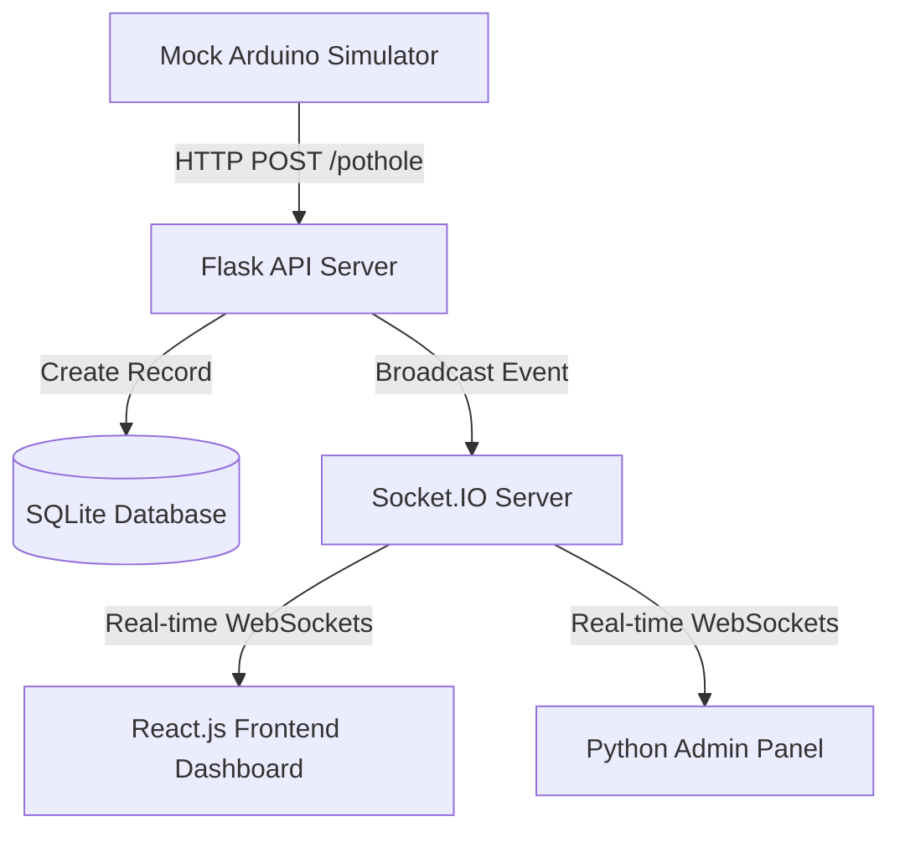

# Smart Pothole Detection & Monitoring System

A modern, full-stack, real-time IoT simulation platform designed to detect, track, and log potholes for municipal management and public safety.

## 🚀 System Architecture & Data Flow



1. **IoT Edge Simulation**: A Mock Arduino Python script sends periodic detections containing a `device_id` and a `status` of `"POTHOLE"` via HTTP POST.
2. **Backend Storage & GPS Mocking**: The Flask server intercepts the payload, dynamically simulates accurate coordinates centering around Roorkee, India (`29.865`, `77.896`), logs the record to the SQLite database, and pushes the event.
3. **WebSockets Broadcast**: Using Flask-SocketIO, the server broadcasts a `new_pothole` JSON payload instantly.
4. **Real-time Clients**: The React Client (connected via `socket.io-client`) captures the websocket event, displays a real-time toast alert, appends the event to the history table, and projects a pulsing GPS marker on an interactive Leaflet dark-map tracker.

---

## 📂 Project Directory Structure

```
Smart-Pothole-System/
├── backend/
│   ├── app.py              # Flask Application Entry Point
│   ├── database.py         # SQLite connection setup
│   ├── models.py           # DB model operations (CRUD & Analytics)
│   ├── routes.py           # REST REST APIs and Jinja2 admin routes
│   ├── socket_server.py    # Socket.IO configurations & broadcasts
│   ├── mock_arduino.py     # Python simulator script
│   └── requirements.txt    # Python dependencies
│
├── frontend/               # React Vite project
│   ├── src/
│   │   ├── components/
│   │   │   ├── MapComponent.jsx  # Interactive Leaflet map container
│   │   │   ├── PotholeTable.jsx  # Tabular logs with search & delete
│   │   │   └── Navbar.jsx        # Dashboard brand header
│   │   ├── pages/
│   │   │   └── Dashboard.jsx     # Main client dashboard
│   │   ├── services/
│   │   │   ├── api.js            # Axios client mapping REST endpoints
│   │   │   └── socket.js         # Socket.IO listener connection
│   │   ├── App.jsx
│   │   ├── index.css             # Glassmorphic dark styling
│   │   └── main.jsx
│   ├── package.json
│   └── vite.config.js
│
├── admin/                  # Jinja2 template Admin Panel
│   ├── templates/
│   │   ├── base.html       # Base template framework
│   │   ├── dashboard.html  # Admin logs table and record stats
│   │   └── analytics.html  # Chart.js statistical metrics
│   └── static/
│       ├── css/
│       │   └── style.css   # Stylesheet for admin panel
│       └── js/
│           └── main.js
└── README.md
```

---

## 🛠️ Tech Stack

- **Backend**: Python 3, Flask, Flask-SocketIO (WebSocket Server), Flask-CORS, SQLite, Eventlet (async server runner).
- **Frontend**: React.js (Vite compiler), Axios, Socket.IO Client, Leaflet Maps, React-Leaflet, Lucide React (Icons).
- **Admin Panel**: Jinja2 Template Engine, HTML5/CSS3, Chart.js.

---

## 📝 API Documentation

### 1. Register Pothole Event
- **Endpoint**: `POST /pothole`
- **Payload**:
  ```json
  {
    "device_id": "A001",
    "status": "POTHOLE"
  }
  ```
- **Response**:
  ```json
  {
    "success": true,
    "data": {
      "id": 12,
      "device_id": "A001",
      "latitude": 29.8631,
      "longitude": 77.8942,
      "status": "POTHOLE",
      "timestamp": "2026-06-12 22:30:15"
    }
  }
  ```

### 2. Get All Records
- **Endpoint**: `GET /potholes`
- **Response**: Array of pothole objects.

### 3. Delete Record
- **Endpoint**: `DELETE /pothole/<id>`
- **Response**:
  ```json
  {
    "success": true,
    "message": "Pothole record 12 deleted."
  }
  ```

### 4. Fetch System Analytics Stats
- **Endpoint**: `GET /potholes/stats`
- **Response**:
  ```json
  {
    "total_potholes": 16,
    "active_devices": 4,
    "latest_detection": "2026-06-12 22:40:00",
    "recent_alerts": [...]
  }
  ```

---

## ⚙️ How to Setup & Run

### 1. Run the Backend (Flask + SQLite)
Open a terminal in the `backend/` directory:
```bash
# Create a virtual environment
python -m venv venv

# Activate virtual environment
# On Windows:
.\venv\Scripts\activate
# On Linux/macOS:
source venv/bin/activate

# Install dependencies
pip install -r requirements.txt

# Start Flask Server
python app.py
```
*The server will boot on `http://localhost:5000`.*
- *Admin Dashboard: `http://localhost:5000/admin`*

### 2. Run the Frontend (React.js)
Open a second terminal in the `frontend/` directory:
```bash
# Install dependencies
npm install

# Run Developer Dev Server
npm run dev
```
*The frontend will run on `http://localhost:5173`.*

### 3. Run the Mock Arduino Simulator
Open a third terminal in the `backend/` directory (with venv activated):
```bash
python mock_arduino.py
```
*This starts posting simulated telemetry triggers every 10 seconds.*
